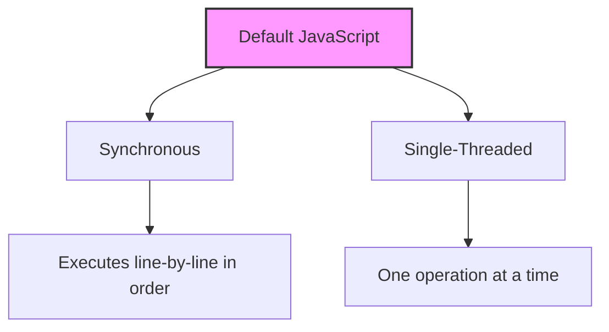
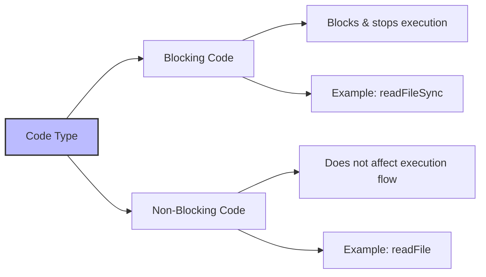
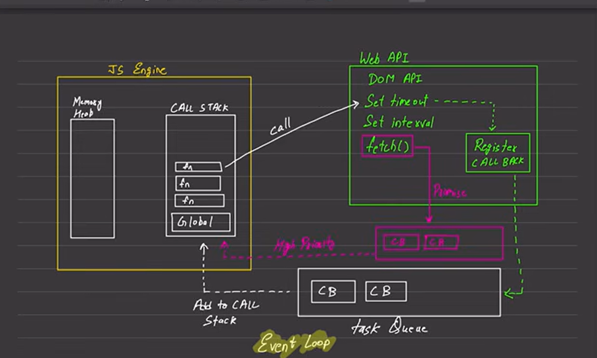

# JavaScript Execution Model and Code Types

### JavaScript Core Classification


### Core Characteristics of JavaScript
By default, **JavaScript** operates under two fundamental principles:
* **Synchronous:** Code is executed sequentially, meaning it runs from top to bottom in the order it is written.
* **Single-threaded:** JavaScript can only execute one command or operation at a time because it has a single call stack.

---

## The Execution Context
The **Execution Context** governs how JavaScript evaluates and runs your code. Its primary rules include:

* **Sequential Waiting:** Each operation must wait for the previous one to fully complete before its own execution begins.
* **Line-by-Line Progress:** It executes exactly one line of code at a time.

```javascript
// Visualizing sequential execution:
console.log(1); // Executes first
console.log(2); // Waits for console.log(1) to finish, then executes
```

> 📌 *Note: The core mechanisms of the Call Stack and Memory Component have been previously discussed.*

---

## Code Execution: Blocking vs. Non-Blocking



| Code Type | Program Execution Impact | Synchronicity | Example Scenario |
| :--- | :--- | :--- | :--- |
| **Blocking Code** | Blocks and stops the program execution until complete. | Synchronous | Reading a file synchronously (`readFileSync`) |
| **Non-blocking Code** | Does not affect program execution; continues running. | Asynchronous | Reading a file asynchronously (`readFile`) |

### Which one is better?
Neither is inherently better than the other. You must choose between them based on your specific **use case**. Different scenarios require the unique features provided by each approach.

---

## The JavaScript Runtime Engine

Below is the conceptual architecture of how the JavaScript Engine interacts with its surrounding environment:



### ⚠️ Key Architectural Notes:
* **Environment Dependencies (Web APIs):** We do not always have access to Web APIs. For example, when running JavaScript outside the browser (like in **Node.js**), the **DOM API is not available** because the DOM is exclusive to browser environments.
* **The Asynchronous Secret:** It is the **Task Queue** (working alongside the Event Loop) that empowers JavaScript to handle tasks quickly and behave asynchronously, despite being single-threaded.
* **Fetch:** also contains a **Promise queue** which is of very **high priority** and works in similar manner as the **Task Queue**. 